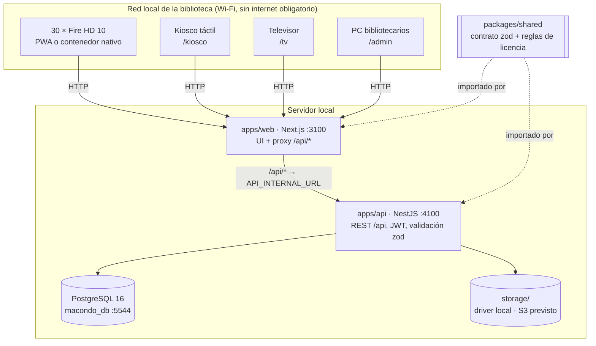
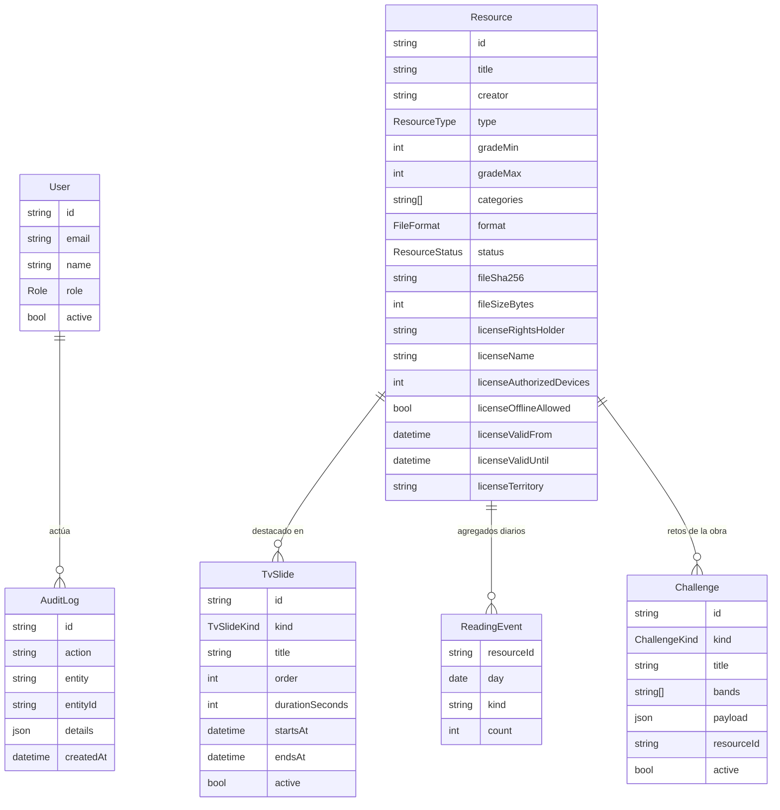
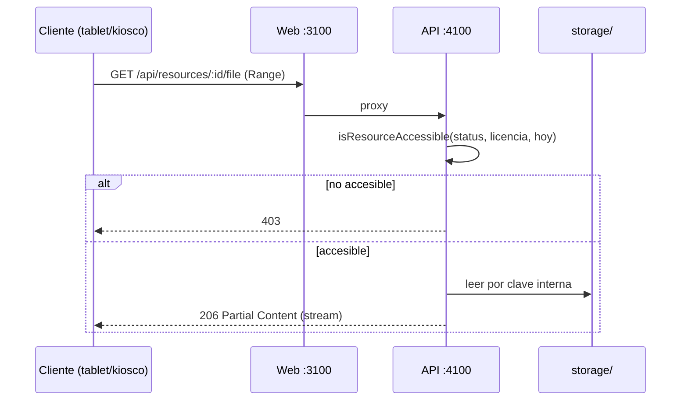

# Arquitectura

## Componentes

| Componente | Responsabilidad |
|---|---|
| `packages/shared` | Tipos, esquemas zod (`ResourceInputSchema` + `ResourceInputBaseSchema`/`ResourcePatchSchema`, `ResourceExtraSchema`, `LicenseSchema`, `TvSlideInputSchema`, `CatalogQuerySchema`, `GalleryManifestSchema`, `ChallengeImportSchema`, `TriviaQuestionSchema`), DTO (`GalleryDTO`, `ChallengeDTO`, `AdminStatsDTO`, `AuditEntryDTO`, `OfflineManifestEntry.assets`), `API_ROUTES`, metas `CAPACITY_TARGETS` (570 recursos: 300/100/50/20/100) y `CHALLENGE_TARGET` (100 retos), fijadas por el usuario el 2026-10-31 (antes 229), bloques de TV `TV_BLOCKS`/`TV_KIND_BLOCK`, reglas puras `isLicenseActive`, `isResourceAccessible`, `canDownloadOffline`, `ALLOWED_UPLOADS` (incluye `zip` → `IMAGE_SET`), `GALLERY_LIMITS`, anchos de miniatura `COVER_THUMB_WIDTHS` (240, 480; `API_ROUTES.resourceCover(id, w?)`). Fuente de verdad. |
| `apps/api` | Catálogo público, streaming de archivos con `Range`, galerías (ZIP validado y extraído), retos lectores, manifest offline, programación TV, administración con roles, auditoría, estadísticas agregadas, seed desde `demo-content/manifest.json`. |
| `apps/web` | Inicio por bandas de grado, `/catalogo` con lectores (epub.js, PDF.js, `<audio>`), `/galeria/[id]` (visor con zoom), `/retos` (trivia, secuencia, relacionar), `/kiosco`, `/tv`, `/admin`. |
| `storage/` | Archivos con clave interna (nunca el nombre del cliente). Abstracción de proveedor para pasar a S3/MinIO (ADR-004). |
| `/opt/piper-venv`, `/opt/piper/voices` (solo en las imágenes Docker) | Piper 1.8.0 + voz `es_ES-davefx-medium` para la narración sintética (ADR-017); proceso aparte, invocado por `TtsService`. |

## Modelo de datos (resumen de `schema.prisma` y del contrato)

- Enums: `ResourceType` (BOOK, AUDIOBOOK, AUDIOBIOGRAPHY, AUDIOSUMMARY, GALLERY), `FileFormat` (EPUB, PDF, MP3, IMAGE_SET, NONE), `ResourceStatus` (DRAFT, PUBLISHED, RETIRED), `Role` (ADMIN, LIBRARIAN), `TvSlideKind` (BOOK_OF_WEEK, FEATURED_AUTHOR, FUN_FACT, GALLERY, AGENDA, CHALLENGE, MESSAGE, TUTORIAL).
- La licencia se guarda aplanada en `Resource` y se expone como objeto `license` en `ResourceDTO`. `accessible` lo calcula la API (publicado + licencia vigente hoy).
- `ReadingEvent` guarda **solo contadores por recurso y día**: sin identidad de estudiante ni de dispositivo.
- Estudiantes: anónimos, sin tabla de usuarios (ADR-006).
- `Resource.gallery` (JSON): metadatos de la galería y claves internas de cada imagen (`galleries/<uuid>.<ext>`); nunca se exponen las claves. `Resource.extra` (JSON, `ResourceExtraSchema`): `timeline`, `funFacts`, `questions`, `text`, `relatedTitle`, `relatedCreator`.
- `Challenge`: id = slug estable de `catalogo-dp/retos/retos.json`; `payload` = `{questions}` | `{steps}` | `{pairs}`; `resourceId` resuelto por título+autor exactos al importar.

## Galerías (IMAGE_SET)

1. `POST /api/admin/resources/:id/file` con `.zip` (solo recursos `GALLERY`; una galería solo admite ZIP).
2. Lector ZIP propio (`apps/api/src/common/zip-reader.ts`, sin dependencias): rechaza ZIP64, cifrado, multi-volumen, métodos ≠ STORE/DEFLATE; verifica tamaño declarado y CRC-32 de cada entrada.
3. `gallery-zip.ts`: rechaza `..`, rutas absolutas, `\`, enlaces simbólicos, más de una carpeta de profundidad, > 60 entradas, > 300 MB descomprimidos y proporción > 100:1 (bomba ZIP); exige un único `gallery.json` válido (zod) y que cada imagen referenciada exista y tenga firma JPG/PNG/WebP real. Ignora `__MACOSX/`, `.DS_Store`.
4. Cada imagen se guarda como objeto propio; el ZIP original queda como archivo del recurso (`fileSha256` = SHA-256 del ZIP).
5. Público: `GET /api/resources/:id/gallery` → `GalleryDTO` y `GET /api/resources/:id/gallery/:index` → imagen (403 si la licencia no está vigente, 404 si es borrador).
6. Offline: la entrada del manifest lleva `galleryUrl` y `assets[]` (url, sha256, tamaño, mime). La web descarga cada imagen, verifica su SHA-256 y solo guarda si todas coinciden; el SW sirve JSON e imágenes desde la caché offline.

## Retos lectores

- Público: `GET /api/challenges?band=&resourceId=` (solo activos; el recurso solo se enlaza si está publicado).
- Admin: `GET /api/admin/challenges`, `POST /api/admin/challenges/import` (arreglo; idempotente por id; conserva `active`), `POST /api/admin/challenges/:id/active`. Auditoría `CHALLENGE_IMPORT` / `CHALLENGE_TOGGLE`.
- Panel (`/admin` → pestaña **Retos**, `ChallengesAdmin.tsx`, marcado PQR): lista completa con filtros locales por banda, tipo, estado y texto (`filterChallenges`), interruptor Activo/Inactivo por reto (`aria-pressed`, usa `:id/active`) y cuadro «Importar JSON» (pegar o cargar `retos.json`; se valida con `ChallengeImportArraySchema` en el cliente antes de llamar al importador y se muestra el resumen creados/actualizados/sin obra). El KPI «Retos lectores» del Resumen enlaza con la pestaña.
- Web: `/retos` carga de la API → copia local → retos incorporados; tipo `match` por toques o listas desplegables (sin arrastrar); insignias solo locales.

## Portadas y miniaturas (2026-11-01, ADR-013)

- `GET /api/resources/:id/cover` sirve el original; `?w=240` o `?w=480` (lista blanca `COVER_THUMB_WIDTHS`) devuelve una **miniatura WebP** (calidad 80, `withoutEnlargement`, orientación EXIF respetada). Cualquier otro ancho → 400. La vista previa del panel `GET /api/admin/resources/:id/cover` acepta el mismo parámetro.
- `ThumbnailService` (`apps/api/src/catalog/thumbnail.service.ts`, `sharp`) genera la miniatura en la **primera petición** y la guarda a través del `StorageProvider` con clave determinista `thumbs/<uuid-de-la-portada>-w<ancho>.webp` (`StorageProvider.put`, escritura atómica). Peticiones simultáneas de la misma miniatura comparten una sola generación. Si la portada no se puede decodificar, se sirve el original (nunca 500).
- ETag = SHA-256 de `coverPath:w<ancho>` → `If-None-Match` responde 304 como la portada original. Al reemplazar una portada su uuid cambia y `removeFor` borra las miniaturas huérfanas.
- Web: `Cover` (`size="grid"` → `src` w=240; `size="large"` → w=480; `srcset` 240w/480w + `sizes`; `width`/`height` 3:4 para no mover la maquetación). Cuadrículas (catálogo, kiosco, inicio) usan `grid`; ficha, detalle del kiosco y TV usan `large`. El manifest offline entrega `coverUrl` con `?w=240` y el SW busca la portada en la caché offline ignorando la consulta si hace falta.
- Medido en el stack real (página 1 del catálogo, 24 portadas PNG 600×900): 8 939 728 B → 162 976 B con w=240 (−98,2 %); w=480: 448 514 B (−95 %). Segunda petición de una miniatura: ~4 ms (ya en disco).

## Panel admin: acciones en lote (2026-11-01)

- `ResourcesAdmin`: casilla por fila/tarjeta (`aria-label="Seleccionar <título>"`) y casilla de cabecera para la página visible; la selección vive por `id` y sobrevive a filtros y paginación. Barra «N seleccionados» con **Publicar seleccionados** / **Retirar seleccionados** (confirmación nativa, coherente con el resto del panel) y «Quitar selección».
- Ejecución **secuencial** (`runSequential`): una llamada por recurso a los endpoints existentes (`POST :id/status` / `DELETE :id`), de modo que la auditoría del servidor registra cada cambio por separado; línea de avance `aria-live` y lista de errores; los recursos que fallaron quedan seleccionados para reintentar. No hay endpoint masivo nuevo en la API.

## Narración sintética en el servidor (2026-11-05, ADR-017)

- **Motor**: [Piper](https://github.com/OHF-Voice/piper1-gpl) 1.8.0 (`piper-tts`, GPL-3) con la voz **`es_ES-davefx-medium`** (22,05 kHz; datos **CC0**, modelo elegido por el usuario tras escuchar las muestras de `entregables/muestras-voz/`). Piper corre como **proceso aparte** (`spawn`) desde su propio venv `/opt/piper-venv`; la API nunca lo enlaza ni importa (`TtsService` solo habla con él por stdin/archivos). El MP3 (64 kbps, mono, 44,1 kHz, ID3 con título y «Biblioteca Macondo») lo codifica `lame` (o `ffmpeg` si es lo que hay en PATH / `TTS_MP3_BIN`).
- **Imágenes Docker** (`apps/api/Dockerfile` y `Dockerfile` raíz, etapa `tts` idéntica en ambas): `python3.11-minimal` + `libpython3.11-stdlib` + `lame` en la etapa final; el venv (`pip install piper-tts==1.8.0`, sin pip ni tests) y la voz se preparan en una etapa de build y se copian. La voz se descarga **en el build** desde `huggingface.co/rhasspy/piper-voices` (`es/es_ES/davefx/medium/`: `.onnx`, `.onnx.json`, `MODEL_CARD`) y se verifica con `sha256sum -c` (`6658b03b…a917`, `0e0dda87…4842`, `420703b5…8f95`). Un paso de humo sintetiza una frase como usuario `node` y la codifica: si el TTS no funciona, la imagen no se construye. Variables fijadas en la imagen: `TTS_ENABLED=true`, `TTS_ENGINE=piper`, `TTS_PIPER_BIN=/opt/piper-venv/bin/piper`, `TTS_VOICE=/opt/piper/voices/es_ES-davefx-medium.onnx`. Otras: `TTS_MP3_BIN`, `TTS_TIMEOUT_MS` (600 000), `TTS_MAX_PARALLEL` (2).
- **`TtsService`** (`apps/api/src/tts/`): `status()` comprueba binario, modelo, `.onnx.json` y codificador sin lanzar Piper; `synthesize(text, { lengthScale?, sentenceSilence?, title? })` normaliza espacios y párrafos (`tts-text.ts`), rechaza más de **40 000** caracteres, agrupa/parte el texto en trozos ≤ 4 000 caracteres por límite de frase (una línea de stdin por trozo; Piper divide cada línea en frases y añade `--sentence-silence`, 0,35 s por defecto), escribe un WAV temporal, lee la duración de la cabecera RIFF, codifica a MP3 y borra el temporal. Cola de **2 síntesis simultáneas** (el resto espera), tiempo máximo por narración (SIGKILL), errores en español: **503 «Narración no disponible: …»** si falta el motor (desarrollo local sin Piper), 500 si Piper/lame fallan. Un `ProcessRunner` inyectable (`TTS_RUNNER`) permite probar sin binario.
- **Endpoints** (ADMIN y LIBRARIAN, JWT): `GET /api/admin/tts/estado` → `TtsStatus { enabled, engine, voice, ok, detail }`; `POST /api/admin/resources/:id/narrar` con `NarrateInput { text?, lengthScale?, sentenceSilence? }` (sin `text` se narra `extra.text`). Reglas: nunca galerías; si el recurso ya tiene EPUB/PDF se rechaza (la narración solo reemplaza audio). El MP3 se guarda por el mismo camino que una subida (`files/<uuid>.mp3`, sha256, tamaño, `format=MP3`, `durationSeconds` redondeado), se borra el archivo anterior, `narrator` = `TTS_VOICE_CREDIT` («Voz sintética Piper es_ES-davefx-medium (datos CC0)») y `licenseName` se actualiza **solo** si ya mencionaba una voz sintética (`updateLicenseVoiceCredit`: «voz sintética Piper es_ES-carlfm-x_low (…)» o «voz sintética macOS…» → crédito nuevo; «CC BY 4.0» o «Dominio público» no cambian; el titular nunca cambia). Auditoría `RESOURCE_NARRATE` (clave, sha256, tamaño, duración, caracteres, trozos, ms, origen del texto, si cambió la licencia). El texto nunca sale del servidor.
- **Panel**: en el formulario de recurso, sección «Archivos», bloque «Narración con la voz de la biblioteca» (`canNarrate`: audiobiografías/audioresúmenes o cualquier recurso con `extra.text`, salvo galerías y EPUB/PDF) con el botón **«Regrabar con la voz de la biblioteca»** (confirmación, estado «Generando narración…», aviso de resultado con tamaño y duración; los campos narrador/duración/licencia del formulario se sincronizan con la respuesta para que «Guardar cambios» no los pise; deshabilitado si el motor no está disponible). El Resumen muestra la línea «Narración: Piper davefx · disponible/no disponible» (`ttsStatusLabel`).
- **Desarrollo local sin Docker**: la API arranca igual y responde 503 en `narrar`. Para probar en el host: `python3 -m venv ~/piper-venv && ~/piper-venv/bin/pip install piper-tts==1.8.0`, descargar la voz (`es_ES-davefx-medium.onnx` + `.onnx.json`) y exportar `TTS_PIPER_BIN=~/piper-venv/bin/piper TTS_VOICE=/ruta/es_ES-davefx-medium.onnx` (y `ffmpeg` o `lame` en PATH). En esta máquina existe un venv de pruebas en `catalogo-dp/_tmp/tts/venv` y la voz en `catalogo-dp/_tmp/tts-muestras/piper-voices/` (temporal, no versionado; la app no depende de él).

## Taller de cuentos «Construye tu cuento» (2026-11-05, ADR-018)

- **Qué es**: `/construye-tu-cuento` (portal, bandas **1-3 y 4-5**; otras bandas ven «próximamente»; no está en el kiosco). Asistente de 3 pasos con mosaicos ≥ 72 px y accesibles por teclado (`role="radiogroup"`): creadores (nombre de autor opcional, nombre del protagonista, tipo 4 opciones) → lugar (4 lugares reales de Sucre + estación espacial) → enseñanza (4 valores). Genera un cuento en español con título, sinopsis, párrafos, 3 preguntas de opción múltiple (reutiliza `TriviaQuiz` de los retos), glosario y recordatorio del valor; narración MP3 con la voz de la biblioteca (ADR-017); portada SVG (`cuentoCoverSvg` del contrato) en el navegador; «Guardar en esta tablet» (localStorage `macondo.cuentos.mios`, máx. 12) y lista «Mis cuentos» en `/offline` y en la portada del taller. Módulo «Taller de cuentos» en el inicio solo para primaria (`moduleVisible`).
- **Contrato** (`packages/shared`): `CUENTO_OPCIONES` (ids `nino|animal|robot|leyenda`, `covenas|mojana|sincelejo|espacio`, `amistad|valentia|curiosidad|cuidado` con los textos de la interfaz), `CuentoNombreSchema` (letras/espacios/apóstrofo/guion, 2–30), `CuentoOpcionesSchema` (strict: banda, autorNombre?, protagonista, tipo, lugar, valor, deviceId), `CuentoGeneradoSchema` (JSON estricto del modelo), `CUENTO_LIMITES` (1-3: 180–320 palabras; 4-5: 350–600; ±20 % al validar), `CuentoDTO`/`CuentoAdminDTO`/`CuentosDisponibleDTO`, `CuentoRevisarSchema`, `CUENTO_LICENSE`, `cuentoGrades`, `cuentoCoverSvg`; rutas `cuentos`, `cuento(id)`, `cuentoAudio(id)`, `cuentosDisponible`, `adminCuentos`, `adminCuento(id)`, `adminCuentoRevisar(id)`; `ResourceExtra.cuentoId`; `AdminStatsDTO.cuentos`.
- **Datos**: modelo `GeneratedStory` (id, band, autorNombre?, protagonista, tipo, lugar, valor, modo `ia|plantilla`, titulo, contenido Json, audioPath/audioDuration/audioError, status `StoryStatus` = GENERATING → GENERATED (texto listo, audio en curso) → PENDING_REVIEW → APPROVED | REJECTED (o FAILED), reviewNote/reviewedBy/reviewedAt, deviceHash, resourceIds Json, providerMs/tokensIn/tokensOut). Migración `20261105143547_generated_story`. **No se guarda IP**; `deviceHash` = SHA-256 de un id aleatorio que la tablet genera en localStorage (`macondo.cuentos.device`).
- **API** (`apps/api/src/cuentos/`): `GET /api/cuentos/disponible` → `{habilitado, bandas, modo}`; `POST /api/cuentos` (202, crea el trabajo y responde `{id, status}`; 400 nombre inválido/vetado o banda no habilitada; **429** al superar `CUENTOS_LIMITE_POR_HORA` por dispositivo (3) o `CUENTOS_LIMITE_GLOBAL_POR_HORA` (60), contados en BD en la última hora); `GET /api/cuentos/:id` (estado + contenido + `audio.url`); `GET /api/cuentos/:id/audio` (MP3 con Range vía `FileStreamerService`). Admin (ADMIN y LIBRARIAN): `GET /api/admin/cuentos?status`, `GET /api/admin/cuentos/:id`, `POST /api/admin/cuentos/:id/revisar {decision: APROBAR|RECHAZAR, nota?}` (auditoría `CUENTO_REVIEW`; 409 si ya fue revisado).
- **Pipeline** (`CuentosService.ejecutar`, en segundo plano tras el 202): `generarTexto` → si hay proveedor: prompt fijo del sistema (`prompt.ts`: español de Colombia, sin violencia/miedo/romance/marcas/religión/política, lugar real de Sucre, longitud por banda, JSON estricto) + prompt de usuario con **solo** banda, opciones cerradas y nombre del protagonista; `extraerJson` → `CuentoGeneradoSchema` → `validarCuento` (`safety.ts`: lista de bloqueo propia, heurística de español por palabras frecuentes, longitud, sinopsis ≤ 40, opciones repetidas, presencia del protagonista, sin enlaces); si falla, **un reintento** con prompt estricto (temperatura 0,5) y, si vuelve a fallar o el proveedor no responde, **modo plantilla** (`plantilla.ts`: fragmentos propios 4 × 4 × 4 con el nombre insertado; ~250 palabras en 1-3, ~320 en 4-5; 3 preguntas y glosario; determinista). Luego `TtsService.synthesize` (título + párrafos) → `files/<uuid>.mp3`; sin motor el cuento queda sin audio (`audioError`). Estado final PENDING_REVIEW.
- **Proveedor** (`llm.provider.ts`): interfaz `LlmProvider` (`available()`, `generate()`), token `LLM_PROVIDER`; `DeepSeekProvider` (Chat Completions compatible con OpenAI, `response_format: json_object`, temperatura 0,8, 60 s de tiempo máximo, red/DNS/HTTP ≠ 2xx → `LlmUnavailableError` → plantilla). Se registran **solo** latencia, modelo y tokens; nunca el prompt (lleva el nombre del protagonista) ni la clave. Sin `DEEPSEEK_API_KEY` → `NoLlmProvider` (modo plantilla). En pruebas se sustituye por un proveedor falso.
- **Aprobar** crea en el catálogo, ya **PUBLISHED**: un **libro** (`BOOK`, EPUB 3 construido en Node por `epub.ts` —misma estructura que `catalogo-dp/_tools/cuentos-build.py`, escritor ZIP propio—, portada PNG rasterizada con `sharp` desde el SVG del contrato —fuente DejaVu en la imagen Docker—, `extra = {cuentoId, text, questions}`) y, si hay audio, un **audiolibro** (`AUDIOBOOK`, copia propia del MP3, `durationSeconds`, `narrator` = crédito de la voz) con el mismo título; `creator` = «<autor> (Taller de cuentos)» o «Taller de cuentos – Biblioteca Macondo»; categorías `cuento`, `cuento original`, `taller de cuentos`; licencia `CUENTO_LICENSE` (titular «Comfasucre – Biblioteca Macondo (Taller de cuentos)»), grados por banda, 30 dispositivos, offline permitido. Retirar los recursos no borra el cuento.
- **Panel**: pestaña **Taller de cuentos** (`CuentosAdmin.tsx`, PQR): lista con filtro por estado (pendientes por defecto), detalle con texto completo, preguntas, glosario, reproductor de audio y botones **Aprobar y publicar** / **Rechazar** con nota (confirmación nativa). KPI «Cuentos por revisar» en el Resumen (`AdminStatsDTO.cuentos`).
- **Configuración**: `DEEPSEEK_API_KEY`, `DEEPSEEK_MODEL` (`deepseek-chat`), `DEEPSEEK_URL`, `CUENTOS_ENABLED`, `CUENTOS_BANDAS` (`1-3,4-5`), `CUENTOS_LIMITE_POR_HORA` (3), `CUENTOS_LIMITE_GLOBAL_POR_HORA` (60), `CUENTOS_TIMEOUT_MS` (60 000), `CUENTOS_AUDIO` (true). `docker-compose.yml` pasa `DEEPSEEK_*` y `CUENTOS_*` a `macondo-api` y fija `dns: [8.8.8.8, 1.1.1.1]` (solo necesario en redes cuyo DNS bloquea `api.deepseek.com`).

## Flujo de acceso a un archivo

## Biblioteca TV (/tv)

- Rotación automática de **6 bloques × 20 s** (ciclo de 2 min): Libro recomendado de la semana (`BOOK_OF_WEEK`), Agenda de actividades culturales (`AGENDA`; también `MESSAGE`), Curiosidades literarias (`FUN_FACT`; también `GALLERY`), Autor colombiano o sucreño destacado (`FEATURED_AUTHOR`), Frases y retos de lectura (`CHALLENGE`), Tutorial de kiosco y tablets (`TUTORIAL`). Mapeo en `TV_KIND_BLOCK` del contrato.
- Pantalla: cabecera blanca con logo Comfasucre («Biblioteca TV · Programación automática»), escenario grande EN PANTALLA (portada autorizada del recurso enlazado, título, autor, sinopsis y QR a `/recurso/<id>`) y rail «Programación» con los 6 bloques, el actual resaltado con barra de avance. Perfil sala (§3.5): Inter, azules, degradado del bloque de llamado.
- Texto por bloque: agenda y tutorial = una línea por actividad/paso; frase = línea 1 cita, línea «— Autor» y luego invitación (QR a `/retos`).
- QR: origen público = `?origin=` en la URL de la TV → `NEXT_PUBLIC_PUBLIC_ORIGIN` (build) → origen de la página. Si la TV abre `localhost`, usar `?origin=http://<IP-del-servidor>:3100`.
- Respaldo: API → última programación guardada (localStorage) → diapositivas institucionales. Escala con `--u` (1080p primero; 720p/4K). Transiciones con `prefers-reduced-motion` respetado.

## Online local vs. offline absoluto

| | Online local | Offline absoluto |
|---|---|---|
| Conectividad | Tablet en el Wi-Fi de la biblioteca; servidor local accesible; internet **no** requerido | Tablet sin red |
| Origen del contenido | Streaming desde la API | Copia local descargada previamente desde `/api/offline/manifest` |
| Control de licencia | En cada petición (403 si vence) | `licenseValidUntil` guardado en el manifest; el cliente oculta lo vencido con el reloj local y revalida al reconectar |
| Progreso | Local, se sincroniza | Local; cola de sincronización idempotente (ver `docs/OFFLINE.md`) |

## Fire OS: PWA primero, contenedor nativo como alternativa

1. **PWA** (Service Worker + Cache Storage/IndexedDB) en Silk u otro navegador instalable sin Google Play. Riesgo: Fire OS puede no garantizar almacenamiento persistente (`navigator.storage.persist()`), ni instalación PWA completa.
2. **Alternativa nativa**: APK con WebView (p. ej. Capacitor) que empaquete la misma web y guarde los archivos en el almacenamiento de la app; instalación por *sideload* (fuentes desconocidas) o MDM. Sin dependencia de Google Play Services.
3. Decisión tras las 7 pruebas físicas de `docs/TESTING.md` (ADR-005). Hasta entonces: **pendiente de validación física**.

## Decisiones

Ver `docs/DECISIONS.md`. Cualquier cambio en `packages/shared` debe reflejarse en API, web y este documento.

## Cambio de contraseña (2026-11-01)

`POST /api/auth/password` (autenticado, limitado por el mismo throttler del login) recibe `ChangePasswordSchema` (`packages/shared`: mínimo 10 caracteres, letras y números, distinta de la actual), verifica la contraseña actual con bcrypt, guarda el nuevo hash (coste 10) y registra `USER_PASSWORD_CHANGE` en la auditoría sin incluir contraseñas. En el panel: botón «Cambiar contraseña» en la barra superior → diálogo `components/admin/PasswordChange.tsx` con validación local idéntica y errores junto al campo. La sesión vigente (JWT 8 h) no se invalida.
