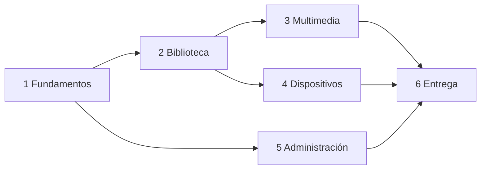

# Roadmap

| Fase | Estado | Depende de | Prioridad |
|---|---|---|---|
| 1. Fundamentos | **En curso** | — | Crítica |
| 2. Biblioteca funcional | Parcial (contenido demo listo) | 1 | Crítica |
| 3. Multimedia educativa | Pendiente | 2 | Alta |
| 4. Dispositivos | Pendiente (plan Fire OS documentado) | 2 (offline), 1 (kiosco/TV) | Crítica — bloquea compra/despliegue en 30 unidades |
| 5. Administración | Pendiente | 1, 2 | Alta |
| 6. Entrega | Pendiente | 1–5 | Alta |

## Fase 1 — Fundamentos (en curso)
Inspección, harness del agente, monorepo npm, Docker (Postgres 5544), esquema Prisma, API base, autenticación JWT del personal, diseño base de la web.
Hecho: contrato compartido (`packages/shared`, 8 pruebas unitarias), docker-compose, documentación y harness. En curso: API y web v1 (agentes paralelos).

## Fase 2 — Biblioteca funcional
Catálogo, filtros, carga validada de archivos, lector EPUB/PDF, reproductor MP3 con reanudación, clasificación por grado/categoría, contenido demo legal (hecho: 8 recursos en `demo-content/`).

## Fase 3 — Multimedia educativa
Fichas de audiobiografía (línea de tiempo, datos curiosos, preguntas), audioresúmenes enlazados a la obra, galerías con zoom y paquete offline, retos lectores con insignias sin rankings nominales.

## Fase 4 — Dispositivos
`/kiosco` (inactividad, QR, bloqueo por SO), `/tv` (programación y recuperación), offline-first (manifest, integridad, sincronización idempotente), validación física en Fire HD 10 de las 7 pruebas obligatorias y decisión PWA vs. contenedor nativo.

## Fase 5 — Administración
Gestión completa de recursos y licencias (alertas de vencimiento), programación TV, estado de dispositivos, estadísticas agregadas, auditoría, roles.

## Fase 6 — Entrega
Revisión de seguridad y privacidad, accesibilidad (axe + manual), E2E completas, rendimiento con 570 recursos, respaldo/restauración probados, documentación final y capacitación de bibliotecarios.
